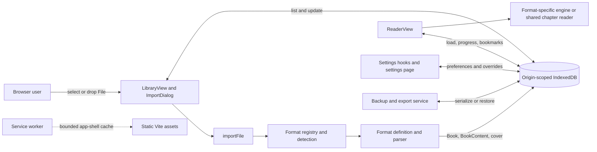

# WebXReader Architecture

This is an implementation guide to the repository as it exists today. WebXReader is a browser-side React application: users choose local files, parsers run in the browser, and the library is persisted in browser storage. Hosted sites distribute the static application; this repository does not provide a book-processing API, user account service, or cross-device library sync.

The companion documents in this directory serve different purposes: [security-audit.md](./security-audit.md) tracks security findings and fixes, while the [unimplemented-features roadmap](./WebXReader-Unimplemented-Features-Roadmap.md) and [format roadmap](./formats-to-be-added.md) describe planned or prospective work. A feature mentioned in a roadmap is not necessarily present in the running app.

## System at a glance

The browser is the runtime boundary. A normal import or reading session does not upload a book to an app server. Browser storage is scoped to the site's origin: the Cloudflare, Netlify, Firebase, and Vercel mirrors listed in the README each have a separate library, as does a local development or self-hosted origin.

## Startup, providers, and navigation

The document shell is [`index.html`](../index.html); it contains the app root, manifest links, structured metadata, and the service-worker bootstrap. [`src/main.tsx`](../src/main.tsx) mounts [`src/App.tsx`](../src/App.tsx) under React `StrictMode` and imports the global stylesheet. The provider and routing order in `App` is:

1. `SettingsProvider` loads global preferences and applies the theme.
2. `HashRouter` owns navigation.
3. `SidePanelProvider` exposes a small shared open/closed state.
4. `Routes` selects the page component.

Hash routing keeps page navigation inside the static app and avoids requiring a host-side rewrite for paths such as `/read/:bookId`.

| Route | Current implementation |
| --- | --- |
| `/` | Main library and import entry point |
| `/read/:bookId` | Reader for a book already stored in this browser origin |
| `/settings` | Preferences, storage status, backup/restore, and data controls |
| `/about`, `/privacy-policy` | Information pages |
| `/series`, `/private-mode`, `/stats` | `PlannedFeaturePage` placeholders |
| Anything else | Redirect to `/` |

There is no server-side route loader. The reader obtains its book and content from IndexedDB after the route mounts.

## Main code boundaries

| Area | Responsibility |
| --- | --- |
| `src/app` | Settings and side-panel providers/context |
| `src/components/library` | Library collection UI, import dialog, book cards/lists/details |
| `src/components/reader` | Reader shell, shared chapter layouts, panels, search, progress, reader settings |
| `src/components/settings` | Global settings, storage/privacy, backup controls, informational pages |
| `src/core/parsing` | Format parsing and common parsing/sanitization helpers |
| `src/core/storage` | IndexedDB operations, browser preference migration, backup serialization/restore |
| `src/features/import`, `src/features/export` | Import orchestration and user-triggered exports/backups |
| `src/features/library` | Session-persisted library view state |
| `src/formats/definitions` | Format metadata, parser adapters, and declared capabilities |
| `src/formats/engines` | EPUB, PDF, comics, DjVu, image, and general archive readers |
| `src/hooks` | React state adapters for books, progress, bookmarks, and settings |
| `public` | Static assets, manifest, and service worker |

The central data types are in [`src/types/book.ts`](../src/types/book.ts). The format contract is in [`src/formats/types.ts`](../src/formats/types.ts). These two contracts connect parsers, persistence, library UI, and readers without making the library page depend on parser internals.

## Library behavior

[`LibraryView.tsx`](../src/components/library/LibraryView.tsx) is the primary collection screen. It uses [`useBooks`](../src/hooks/useBooks.ts), which loads book metadata and reading progress separately, combines them for display, resolves cover records, and keeps a module-level in-memory collection cache. Library actions write through database functions and refresh that collection.

The view supports search across title, author, tags, original filename, and source format; status/favorites/archive filters; layout and sort preferences; custom order and drag reordering; metadata/cover editing; selection and deletion; and individual original-file export. The search/filter and scroll position used while moving between the library and reader are saved by [`library-state.ts`](../src/features/library/library-state.ts) in `sessionStorage`, with an in-memory copy for synchronous restoration.

The library is not a live IndexedDB query view. It loads records into React state, derives filtering/sorting in memory, and refreshes after operations. Reading progress is joined into the displayed collection rather than written into each persisted `Book` record.

## Import pipeline

The import dialog accepts a file selection or a library drop. Multi-file imports are processed one at a time, and each file gets an independent imported/duplicate/failed result. A large-file threshold in settings changes the progress message; it is a warning, not a global import rejection limit.

[`import-service.ts`](../src/features/import/import-service.ts) coordinates each import:

1. Reject a zero-byte file.
2. Resolve a format from the filename/extension first, then MIME type. `.fb2.zip` is a special filename case treated as FB2.
3. Read the file as an `ArrayBuffer` for hashing and possible format sniffing. If no definition was found, the fallback signature check recognizes supported image formats; it is not a general binary sniffer for every format.
4. Compute a content hash and check for an existing book. `forceImport` skips this duplicate check.
5. Call the registered format parser with options such as text encoding and chapter autodetection.
6. Construct a lightweight `Book` metadata record and separate `BookContent` payload. Use parser-provided original bytes when present, or keep the original buffer when the definition requires it.
7. Save book metadata, content, and an optional cover in a single IndexedDB read/write transaction.

The format parser can read the file again after the import service reads it for the hash. The system does not impose one streaming parser or one shared worker pipeline; memory use, validation, and decompression behavior vary by format and underlying library.

### Format registry and parser output

[`registry.ts`](../src/formats/registry.ts) builds extension and MIME lookup maps from the format definitions and provides the file input `accept` string, format lookup, fixed-layout classification, and capability checks. The registry contains these 20 formats:

| Family | Registered formats | Typical implementation |
| --- | --- | --- |
| Reflowable text/documents | TXT, Markdown, HTML, RTF, FB2, MOBI, AZW3/KF8, DOCX, DOC, MHT | Parser produces normalized chapter HTML/text and a table of contents; shared chapter readers render it |
| EPUB | EPUB | Import reads metadata/TOC and keeps the source package; EPUB.js renders the original package in the reader |
| Page-oriented documents | PDF, DjVu | Import records metadata/TOC and keeps source bytes; PDF.js or DjVu/WASM renders later |
| Comics | CBZ, CBR, CB7/7z | Import reads archive metadata/TOC/cover and retains bytes; comic engine opens pages when reading |
| Standalone images | PNG, JPEG | Image parser records dimensions/format information and retains bytes; image engine handles presentation |
| General containers | ZIP, RAR | Import records an entry listing and keeps the archive; the archive reader opens supported entries on demand |

Parser output is intentionally format-dependent. The common `FormatParsedData` shape can carry metadata, table of contents, chapter bodies, raw text, an original file buffer, and a cover image; not every parser fills every field. `Book.tableOfContents` is the lightweight navigation model, while full chapter bodies (when available) live under `BookContent.chapters`.

Most reflowable document formats persist parsed text/chapters rather than the original source bytes. EPUB, PDF, DjVu, comics, archives, and standalone images retain original bytes because their reader engines need the source document/archive. For a parsed format with no retained original buffer, individual-book export falls back to a text reconstruction rather than recreating the original DOC/RTF/MOBI/etc. file.

Some useful implementation details:

- Markdown/HTML and converted document content pass through shared HTML sanitization before reader insertion.
- EPUB import keeps the binary and TOC rather than persisting all chapter HTML; the reader opens that binary again.
- PDF import extracts metadata, outline/navigation, and a cover preview; PDF.js handles page rendering and engine search in the reader.
- ZIP/RAR container imports create an entry model. `ZipReader` opens supported nested book/document entries or image collections without adding each entry to the library as a separate `Book`.
- TXT/MOBI/AZW3/DOC/FB2 and related parsers can use chapter detection or encoding options according to their individual definitions; these are parser options, not a uniform capability of every format.

Format libraries are isolated behind parser adapters and reader engines. Dependencies include EPUB.js, PDF.js, `djvu-rs`, `7z-wasm`, JSZip, Mammoth, CFB, Markdown tooling, and DOMPurify. Vite also assigns several large dependency groups to separate build chunks.

### Archive safety is format-specific

The general ZIP parser validates entry paths and applies declared limits for entry count, per-entry size, cumulative uncompressed size, and compression ratio. The reader also sanitizes ZIP entry paths to reject traversal segments. These checks are specific to those code paths; they are not a single shared budget automatically applied to every ZIP-based parser/reader such as EPUB, DOCX, or CBZ. The import dialog's large-file warning is advisory. See [security-audit.md](./security-audit.md) for the audit's detailed format-specific risks and status.

## Reader lifecycle and engines

[`ReaderView.tsx`](../src/components/reader/ReaderView.tsx) loads the `Book` and `BookContent` in parallel. The progress and reader-settings hooks load alongside that request; the view waits for all three before mounting the reading stage. It chooses an engine from the stored `sourceFormat` and whether the needed original bytes are present. Large engines are dynamically imported and rendered inside `Suspense`, so the library's initial bundle does not need to eagerly load every format engine.

The reader shell owns shared navigation and state: table of contents, search, bookmarks, reading settings, zoom/fullscreen controls, keyboard shortcuts, and the progress bar. It translates engine callbacks into the common progress model and flushes pending progress when the user leaves the reader.

| Engine/component | Role |
| --- | --- |
| `EpubReader` | Facade selecting EPUB scroll, horizontal, or double-sided implementation; EPUB.js backs package rendering and locations |
| `PdfReader` | PDF.js document/page rendering, text search, scroll/page/horizontal modes; vertical mode delegates to `PdfDoubleSidedReader` |
| `CbzReader` | CBZ/CBR/CB7 page collection, page/spread/scroll modes, reading direction, fit, gap, and zoom |
| `DjvuReader` | DjVu document and page rendering backed by the DjVu/WASM parser/runtime |
| `ImageReader` | Single image presentation, fit/zoom/pan behavior |
| `ZipReader` / `ArchiveReader` | ZIP/RAR directory explorer; decompresses supported entries on demand and delegates them to suitable readers/parsers |
| `ScrollReader`, `PaginatedReader`, `DoubleSidedReader` | Shared layouts for chapter-based parsed content |

Archive reading is a second-stage operation: the archive remains one library item; selecting an entry opens it in the current archive reader session. Images in a folder are treated as a navigable image collection. Supported EPUB/PDF/DjVu/comic entries use their own engines; supported text and document entries are parsed locally for display. Unsupported entries can still appear in the directory listing but cannot be opened as a reader document.

### Reading modes and capability flags

`ReadingMode` values are `scroll`, `paginated`, `vertical`, and `horizontal`. In the reader settings UI, `vertical` is used for the **Double Sided** spread choice; it does not mean vertical scrolling. A format definition's capability flags drive which controls/settings are offered, but the flags are declarations, not a universal renderer. `ReaderView` and the engines apply format-specific fallback behavior. For example, TXT is forced to scroll mode; unsupported horizontal/vertical requests are normalized for some formats; EPUB maps its page/spread choices to its double-sided implementation; PDF uses vertical mode for two-page spreads.

Consequently, do not infer the exact rendered behavior from `FormatCategory` or a single capability bit. `fixed-layout` is used for engine/settings policy and includes archives as well as page-like documents; it does not mean every entry inside an archive is a fixed page.

### Search and navigation

The search panel searches parsed chapter text locally for formats with chapter bodies and strips script/style-like nodes before building searchable text. Format engines can provide location-aware search results; the current reader shell wires that provider to EPUB and PDF. The search hook also has a DjVu engine branch, but the drawer wiring is narrower, so the registry `search` flag should not be read as a guarantee that all formats expose the same engine-backed search flow.

TOC selection routes to engine-specific methods where needed (EPUB href, PDF/DjVu page, comic page); otherwise it scrolls to the chapter element. Bookmarks store a common overall position plus format-specific location fields where useful, such as EPUB CFI. PDF/DjVu/comic bookmarks map to page numbers; reflowable books jump to a chapter then restore a relative position.

Progress stores overall fraction, reading mode, and format-appropriate location data: scroll pixels, page index, chapter ID, or EPUB CFI. `useReadingProgress` debounces persistence by two seconds and flushes on cleanup/reader exit. It marks a book `reading` after progress becomes positive and `completed` at 98% or above; `lastOpenedAt` is refreshed when status changes or after a 30-second interval.

## Settings, library state, and persistent entities

[`database.ts`](../src/core/storage/database.ts) owns the `webxreader` IndexedDB database. Its schema is currently version 1 and creates these stores:

| Store | Key | Contents |
| --- | --- | --- |
| `books` | `id` | Book metadata and lightweight TOC; indexed by title, author, hash, dates, status, favorite, archive |
| `bookContent` | `bookId` | Parsed chapters/raw text and/or retained original bytes |
| `progress` | `bookId` | Latest reading location/progress |
| `bookmarks` | `id` | Book-associated reading locations; indexed by `bookId` |
| `annotations` | `id` | Annotation records; indexed by `bookId` |
| `settings` | `id` | Legacy/fallback global preferences |
| `bookSettings` | `bookId` | Per-book reader overrides |
| `covers` | `bookId` | Cover data used when it is stored separately from the book record |

`saveBookBundle` writes book metadata, book content, and an optional cover in one transaction. Deletion removes a book's associated progress, bookmarks, annotations, per-book settings, content, and cover. The database wrapper also exposes storage estimate and persistent-storage request APIs when the browser supports them.

Global preferences are read primarily from local storage under `webxreader.preferences.v1`. If absent, the storage layer reads a legacy IndexedDB preference and attempts to migrate it to local storage. If local storage writes are unavailable, it falls back to IndexedDB. The schema still has a settings store for compatibility; current general preferences are not simply stored there in the normal path.

`useReaderSettings` composes global defaults, optional global-per-format settings, and per-book overrides. The “This Book Only” toggle snapshots current effective settings when enabled; disabling it makes the book use shared settings again. Theme and word spacing remain global in the effective settings model. The site-wide `useSettings` hook picks the system light/dark theme when no saved settings exist, then persists explicit changes.

The database includes annotation read/write operations and backup fields, but the current reader UI exposes bookmarks rather than an annotation/highlight workflow. `ReadingSession` has a type definition but there is no corresponding store or current session-history pipeline. Series, private mode, and statistics routes are placeholders rather than completed features.

## Backups, restoration, and original-file export

[`backup-service.ts`](../src/features/export/backup-service.ts) provides user-triggered downloads; there is no automatic cloud backup or sync.

- Library backups are JSON format version 2. They include book records, progress, bookmarks, annotations, settings, per-book settings, and serializable content. `ArrayBuffer` source files are encoded as base64; chapter content is copied as structured data.
- Restore accepts versions 1 and 2. It skips books whose ID or content hash is already present instead of replacing the existing item, and restores progress/bookmarks/annotations/per-book settings only for book IDs accepted from that backup. Version 1 backups may omit content; those books can be restored with a warning/error entry.
- Restored chapter HTML is sanitized again before persistence. Backup content shape and chapter structure are validated before the database transaction.
- Global preferences from a backup are saved after the IndexedDB restore transaction completes. General preferences are therefore part of the restore operation, not just book data.
- Individual-book export returns retained source bytes where available. Otherwise it generates plain text from raw text or chapter content; that is a readable fallback, not a byte-for-byte reconstruction of the source document.

The library clear action clears books and associated reading data while preserving general site preferences. Preference reset/removal is a separate operation.

## Untrusted content and network boundaries

Imported HTML is not treated as trusted application markup. [`sanitize-reader-html.ts`](../src/core/parsing/sanitize-reader-html.ts) uses DOMPurify with explicit element/attribute allowlists and fails closed if DOMPurify cannot be initialized. Image/SVG support is opt-in at the call site. The same module sanitizes untrusted book CSS before style-text insertion: it removes style-breaking markup, `@import`, external CSS `url()` resources, legacy expressions, and `-moz-binding`.

EPUB has multiple rendering paths. The EPUB.js scroll path renders package sections in its iframe-based rendition and rewrites/checks image sources through package resource resolution. Horizontal and double-sided views place sanitized section HTML into their own reader layout and sanitize author CSS before applying it. External `http:`, `https:`, and protocol-relative image resources are filtered; package-owned resources are resolved through the EPUB resource/archive map. The CSP is an additional browser-level control, not a replacement for these content checks.

The checked-in Netlify, Vercel, and Firebase response policies restrict image, connection, frame, worker, and other resource sources to the app origin plus selected `blob:`/`data:` schemes, and set headers such as `X-Content-Type-Options`, `Referrer-Policy`, `Permissions-Policy`, and `X-Frame-Options`. Sanitized document hyperlinks can remain user-navigable; the local-first model is not a promise that all user-initiated navigation is offline.

The cover editor has a separate, explicit remote-cover URL path. It attempts a CORS fetch without credentials and optimizes successful downloads locally; if the host blocks that read, it can fall back to keeping the remote URL. That fallback depends on the deployment's image CSP and may be restricted by the checked-in `img-src` policy. This path is separate from book parsing and EPUB embedded-resource filtering.

## Offline application shell and deployment

The production app is a Vite static build in `dist/`. `index.html` registers [`public/sw.js`](../public/sw.js) after page load on non-local HTTP(S) hosts. On `localhost`, `127.0.0.1`, or `::1`, it unregisters service workers and clears caches with the `webxreader-` prefix so development does not run against a stale production shell.

The service worker is deliberately an app-shell cache, not a general request proxy:

- It handles same-origin GET requests inside its registration scope. Non-GET and out-of-scope requests pass through.
- It recognizes the app entry, a fixed shell-file allowlist, and hashed assets under `assets/` with selected static extensions. It does not cache arbitrary paths, development source modules, Vite HMR traffic, or cross-origin resources.
- During installation it fetches the current `index.html`, discovers referenced known shell assets, and caches eligible responses. If offline, navigation tries the network first and falls back to the cached app entry. Known static assets are served cache-first, then fetched and cached.
- Cache writes read and bound the actual response body, with a 5 MiB per-entry ceiling, 64 MiB total, and 200-entry ceiling. Eviction keeps the application entry when possible. Activation removes older caches with the app's prefix.

Offline reading therefore depends on both sides being present: the app shell/runtime assets in Cache Storage and the user's imported library in IndexedDB. Browser storage remains subject to quotas/eviction; the app exposes storage estimates, a persistent-storage request, and manual backup/export controls.

The README lists Cloudflare Pages, Netlify, Firebase, and Vercel mirrors. This repository includes Netlify and Vercel configuration and a Firebase Hosting workflow/configuration; the production Firebase workflow runs on pushes to `main`, builds with Node 22 and `npm ci`, then deploys Hosting. Cloudflare Pages is listed as a mirror, but this repository has no equivalent named Cloudflare deployment config. Header behavior should be checked per actual host rather than assumed identical from one config file.

## Build and verification layout

`package.json` defines the common local commands:

| Command | Purpose |
| --- | --- |
| `npm run dev` | Vite development server |
| `npm run build` | `tsc -b` followed by Vite production build |
| `npm run lint` | Oxlint |
| `npm test` | Vitest run |

Vite targets ES2022, disables source maps for production, and manually separates larger vendors such as React/router, EPUB.js, PDF.js, DjVu, 7z, ZIP, parser libraries, and icons. Unit/component tests live under [`src/test`](../src/test); service-worker behavior tests live under [`tests`](../tests). The checked-in GitHub Actions workflow is a Firebase deployment workflow, not a general test/lint CI workflow.

## Current-state caveats

- The `FormatDefinition.capabilities` matrix is used to shape controls, but individual engines and `ReaderView` still own mode fallbacks. A capability flag alone does not describe all edge behavior.
- The general ZIP parser's path/size checks do not automatically cover every format parser that happens to read a ZIP container. Format-specific validation and decompression limits differ.
- Parsed text/document formats commonly lose original source bytes on import; “export original book” falls back to generated text when no binary was retained.
- The annotation schema and backup format are ahead of the current reader UI; a stored annotation type is not evidence of a user-facing annotation workflow.
- Browser-local storage is per-origin and best-effort unless the browser grants persistent storage. The app has no built-in account-based sync.

These points are implementation boundaries, not roadmap commitments. For outstanding security findings and phase status, use [security-audit.md](./security-audit.md); for planned features, use the roadmap documents above.
