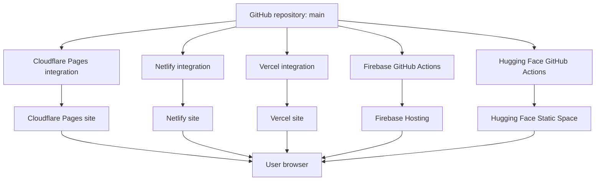

# Deployment architecture

## Overview

WebXReader is a static, local-first React application built with TypeScript and Vite. Its production build uses `npm run build` (`tsc -b && vite build`) and produces `dist/`. The five hosting providers serve the application independently; none is a primary host.

The provider-side integration details for Cloudflare, Netlify and Vercel are not completely represented in this repository. The diagram describes their conceptual connection to the GitHub source; verify actual dashboard settings before treating a trigger or branch policy as established.

## Shared and independent parts

| Shared | Independent by provider |
| --- | --- |
| Application source in `main` | Hosting infrastructure and public hostname |
| Vite/TypeScript build inputs | Deployment execution, timing and status |
| Static application behavior | HTTP headers, redirects, caching and asset serving |
| Application bugs present in the same revision | Provider-specific outages and configuration errors |

The two explicit GitHub Actions deployment workflows are [Firebase](../.github/workflows/firebase-hosting-production.yml) and [Hugging Face](../.github/workflows/deploy-huggingface.yml). They build independently. Netlify has a [build configuration](../netlify.toml); Vercel has [provider configuration](../vercel.json). Cloudflare Pages has no dedicated deployment workflow in the inspected repository.

A source or build defect can affect every mirror once the same revision is deployed. A provider outage may affect only that mirror. Different deployment timings mean mirrors can temporarily serve different revisions.

## Routing

The application uses React Router `HashRouter`. Paths such as `/#/settings` are interpreted in the browser. Direct server requests to `/settings` may return 404 without a provider rewrite, so link to hash-based routes. This is particularly important on Hugging Face Static Spaces.

## Storage and offline behavior

Each origin has separate IndexedDB data and browser caches. The same user visiting Cloudflare, Netlify, Firebase, Vercel and Hugging Face will have five independent browser libraries unless they manually export and restore data. Service workers and offline caches are also origin-scoped. Browser storage can be cleared or evicted; hosting redundancy does not itself back up user libraries.

## Security and response headers

The repository declares security headers in [netlify.toml](../netlify.toml), [vercel.json](../vercel.json) and [firebase.json](../firebase.json). These configurations are not automatically shared with Cloudflare Pages or Hugging Face. Compare live response headers for each origin before assuming identical CSP, framing protection, caching or permissions behavior.

## Deployment ownership

- GitHub repository: application source and documented workflows.
- Provider dashboards: account permissions, repository connections, build settings and any provider-specific environment settings.
- GitHub Actions secrets and Google Cloud IAM: deployment credentials and trust relationships.
- Browser: user library and preferences, not the hosting providers.

Keep the [repository architecture guide](../Developmental/Architecture.md) focused on application internals; this document covers deployment and hosting.
